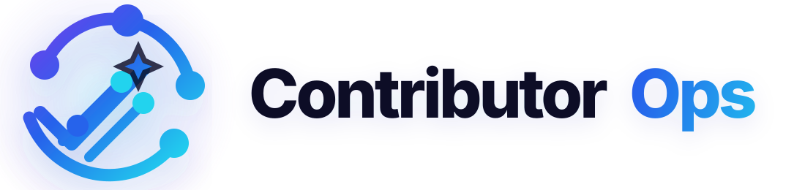
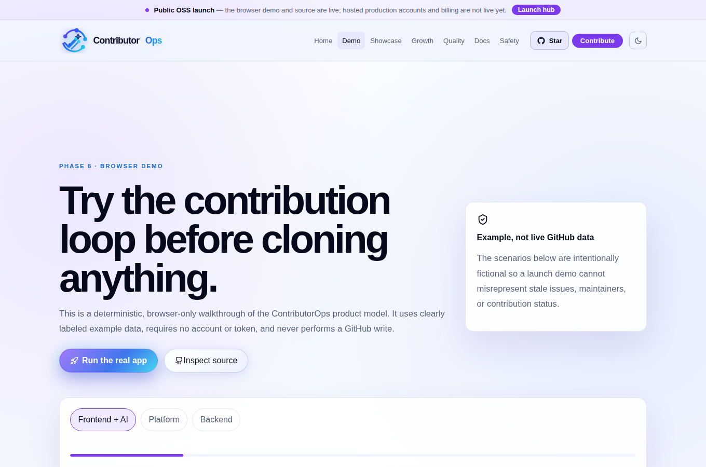
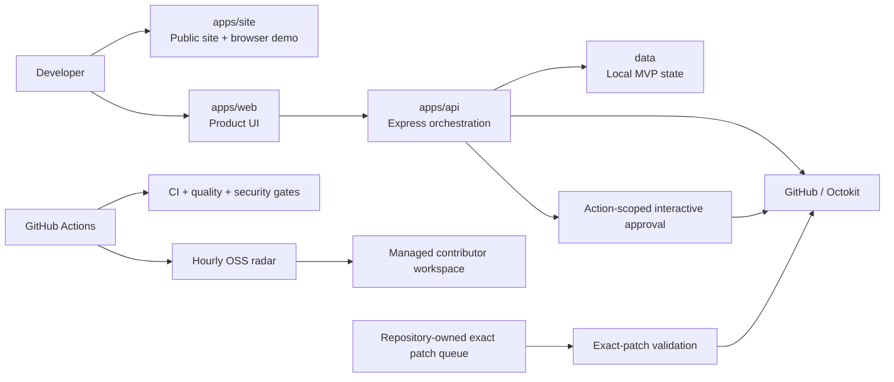

# ContributorOps

<p align="center"><picture>
  <source media="(prefers-color-scheme: dark)" srcset="./apps/site/public/contributorops-logo-dark.svg">
  <source media="(prefers-color-scheme: light)" srcset="./apps/site/public/contributorops-logo-light.svg">
  
</picture></p>

<p align="center"><strong>Find worthwhile GitHub issues. Prepare better PRs. Turn merged work into verifiable career proof.</strong></p>

<p align="center">
  <a href="https://ankitparekh007.github.io/contributorOps/#/demo"><strong>Try the browser demo</strong></a> ·
  <a href="https://ankitparekh007.github.io/contributorOps/#/try">Run locally / Codespaces</a> ·
  <a href="./docs/case-study-floating-ui-3494.md">Real merged PR case study</a> ·
  <a href="./CONTRIBUTING.md">Contribute</a>
</p>

<p align="center">
  <a href="https://github.com/AnkitParekh007/contributorOps/actions/workflows/ci.yml"></a>
  <a href="https://github.com/AnkitParekh007/contributorOps/releases"></a>
  <a href="./LICENSE"></a>
</p>

[](https://ankitparekh007.github.io/contributorOps/#/demo)

*Actual screenshot from the running site. Its guided issue scenarios are explicitly fictional; [inspect a real merged upstream contribution](./docs/case-study-floating-ui-3494.md) separately.*

## See what ContributorOps is for

Most developers can find open-source issues. The hard part is choosing a useful one, submitting a reviewable change, and showing what was actually delivered.

**ContributorOps connects those steps:** discover role-relevant OSS work → prepare a focused implementation and test plan → check repository policy and PR quality → obtain bounded authorization for external actions → retain evidence you can link in interviews.

### Verified upstream result

**[Floating UI PR #3494](https://github.com/floating-ui/floating-ui/pull/3494) was merged October 26, 2026.** It fixes iOS overlay scroll restoration by making the saved-position restore instantaneous and includes a patch changeset for `@floating-ui/react`. The upstream PR explicitly discloses ContributorOps-assisted preparation and its safety checks.

[Read the verifiable case study](./docs/case-study-floating-ui-3494.md) · [Inspect the upstream code and PR conversation](https://github.com/floating-ui/floating-ui/pull/3494)

> This is one publicly verifiable outcome, **not** a claimed success rate or hiring result. The browser demo uses fictional scenarios; the project is runnable locally, but a hosted multi-user SaaS is not live.

## Try it in under a minute

| Start here | What you will see | GitHub token? |
| --- | --- | --- |
| [Interactive browser demo](https://ankitparekh007.github.io/contributorOps/#/demo) | Discover → Prepare → Validate → Authorize → Prove using clearly labeled example issues | **No** |
| [GitHub Codespaces](https://codespaces.new/AnkitParekh007/contributorOps?quickstart=1) | The actual React + Express app in demo-safe mode | **No** for demo |
| [Local quick start](https://ankitparekh007.github.io/contributorOps/#/try) | Clone, install and run the real product locally | **No** for demo |

```bash
git clone https://github.com/AnkitParekh007/contributorOps.git
cd contributorOps
npm ci
npm run dev
```

Node.js 20+ and npm 10+ are required. Live authenticated GitHub actions require credentials and separately defined authorization. Without a GitHub token, discovery uses demo fixtures.

## What it does

| Step | Developer outcome |
| --- | --- |
| **Discover** | Search and score OSS issues relevant to your stack and intended role |
| **Prepare** | Get scoped files, test ideas, a branch plan and maintainer-ready PR language |
| **Validate** | Check quality, duplicates, policies and contribution safety before acting |
| **Authorize** | Inspect specific actions or explicitly enable a tightly bounded exact-patch queue |
| **Prove** | Export contribution history into portfolio entries, resume bullets and interview stories |

ContributorOps is **not** a PR-spam engine. An LLM-generated plan never grants authority to write to somebody else's repository. Interactive writes require action-scoped approval; a separate standing-authorized queue only executes pre-authored bounded patches and opens draft PRs. [Read the security model](./docs/security-model.md).

## Help improve it

Start with [good first issues](https://github.com/AnkitParekh007/contributorOps/issues?q=is%3Aissue+is%3Aopen+label%3A%22good+first+issue%22), read [CONTRIBUTING.md](./CONTRIBUTING.md), or [report workflow feedback](https://github.com/AnkitParekh007/contributorOps/issues/new/choose). We welcome documentation fixes, accessibility improvements, tests and careful trust-boundary reviews. If you are new to the project, the [Contribute page](https://ankitparekh007.github.io/contributorOps/#/contribute) explains where to start.

### Engineering reference

- [Architecture](./docs/architecture.md) · [Security boundaries](./docs/security-model.md) · [Safety policy](./docs/safety-policy.md)
- [API/Web/Site quality gates](./docs/quality-gates.md) · [Architecture decision records](./docs/adr/README.md)
- [Live website](https://ankitparekh007.github.io/contributorOps/) · [Engineering showcase](https://ankitparekh007.github.io/contributorOps/#/showcase) · [Launch and growth plan](./docs/phase-9-growth-operating-system.md)
- [Releases](https://github.com/AnkitParekh007/contributorOps/releases) · [Roadmap](./docs/roadmap.md)

---

## Authorization model

A generated plan is **never authority by itself**.

ContributorOps supports two intentionally separate paths for maintainer-facing execution.

### 1. Interactive action-scoped approval

Interactive contribution runs follow:

```text
prepare → inspect exact payload → approve exact action → execute → retain audit event
```

New runs receive separate approval capabilities for:

- comment
- fork branch
- draft PR

A capability for one action cannot authorize another. Legacy generic run tokens fail closed for new writes.

### 2. Standing exact-patch authorization

The operator can separately enable a repository-owned exact-patch queue for bounded unattended execution.

A queued patch must already contain the concrete files, exact replacements, commit metadata, PR copy, and test evidence. Before execution ContributorOps re-checks:

- open/non-archived repository and issue state
- detected repository policy, including AI-contribution prohibitions
- existing PRs referencing the issue
- same-repository/day duplication
- global daily PR cap
- safe paths and bounded file/replacement scope
- exact single-match replacement against current source

Ambiguity or source drift fails closed. Successful standing submissions remain **draft pull requests** and include automation disclosure.

Read [`docs/security-model.md`](./docs/security-model.md) and [`docs/safety-policy.md`](./docs/safety-policy.md).

## Architecture at a glance



The project originally established human-approved interactive writes in [ADR-0001](./docs/adr/0001-human-approved-external-writes.md). The current [security model](./docs/security-model.md) documents how that interactive path coexists with the separately authorized exact-patch queue.

## Repository map

```text
contributorOps/
├─ .devcontainer/ # one-click Codespaces environment
├─ apps/
│  ├─ api/        # discovery, scoring, planning, GitHub safety + execution paths
│  ├─ web/        # interactive product application
│  └─ site/       # public product, demo, launch, recruiter, adoption, quality, safety
├─ data/           # local MVP state + standing patch queue inputs/results
├─ docs/
│  ├─ adr/         # architecture decision records
│  └─ ...          # architecture, safety, quality, adoption, launch, distribution
├─ scripts/        # deterministic site-quality and Lighthouse harnesses
├─ .github/        # CI, CodeQL, dependency review, Pages, radar, patch-queue workflows
├─ lighthouserc.json
├─ CHANGELOG.md
├─ CITATION.cff
├─ CONTRIBUTORS.md
└─ README.md
```

## Core capabilities

### Opportunity intelligence
- issue discovery across external repositories
- role-aware scoring and filtering
- daily/hourly contribution radar
- stack-oriented prioritization

### Contribution preparation
- scoped contribution plans
- likely file and testing suggestions
- maintainer-question drafting
- branch, commit, and PR draft generation
- managed contributor forks/workspaces
- bounded executable exact-patch plans

### Quality, trust, and security
- PR quality scoring
- deterministic pre-submit checks
- action-scoped interactive approvals
- exact-patch standing authorization
- repository-policy and duplicate checks
- per-repository and global daily limits
- draft-only standing submissions
- auditable approval/run state
- runtime high/critical npm audit merge gate
- full dependency audit reporting
- CodeQL static analysis
- Dependabot update policy
- optional Dependency Review hard gate when GitHub Dependency Graph is enabled
- CycloneDX SBOM generation
- route/metadata integrity validation
- Lighthouse quality budgets
- API/Web/Site TypeScript and build checks

### Proof-of-work packaging
- contribution portfolio tracking
- public contribution pages
- GitHub resume export
- LinkedIn draft generation
- interview STAR story generation
- recruiter-facing summaries

### Adoption and launch operations
- browser-only no-signup demo
- local/Codespaces real-app evaluation
- public Launch Hub
- live GitHub adoption dashboard
- optional privacy-first analytics, disabled by default
- audience-specific Share Hub
- structured workflow-feedback intake
- contributor-retention playbook
- channel-specific public launch execution guide

## Quick start

### Prerequisites
- Node.js 20+
- npm 10+

### Install

```bash
git clone https://github.com/AnkitParekh007/contributorOps.git
cd contributorOps
npm ci
```

### Run API + product UI

```bash
npm run dev
```

Without a GitHub token, the product can use its demo discovery path; authenticated GitHub actions remain unavailable.

### Run the public site

```bash
npm run site:dev
```

### Validate the workspace

```bash
npm run test:api
npm run typecheck
npm run build:all
npm run site:quality
npm run site:lighthouse
npm run security:audit:runtime
```

See [`docs/environment-setup.md`](./docs/environment-setup.md) and [`docs/local-development.md`](./docs/local-development.md).

## Current project boundary

| Area | Status |
| --- | --- |
| Public product + documentation site | ✅ Live |
| Browser-only no-signup walkthrough | ✅ Implemented |
| Local / Codespaces real-app path | ✅ Implemented |
| Engineering showcase + recruiter brief | ✅ Implemented |
| Public Launch Hub | ✅ Implemented |
| Audience-specific Share Hub | ✅ Implemented |
| Public GitHub adoption dashboard | ✅ Implemented |
| Public Quality Gates surface | ✅ Implemented |
| Route-level metadata + site-quality gate | ✅ Implemented |
| Lighthouse quality budgets | ✅ Implemented |
| Interactive action-scoped approval | ✅ Implemented |
| Standing exact-patch authorization | ✅ Implemented |
| Managed contributor workspace / forks | ✅ Implemented |
| Runtime dependency-security gate | ✅ Implemented |
| CodeQL + Dependabot | ✅ Implemented |
| Safety/security/architecture documentation | ✅ Implemented |
| Distribution + launch execution playbooks | ✅ Implemented |
| Optional privacy-first site analytics hook | ✅ Implemented, disabled by default |
| GitHub Dependency Review hard gate | 🟡 Workflow ready; Dependency Graph must be enabled in repository settings |
| Real billing/payments | 🟡 Planned |
| Per-user GitHub OAuth | 🟡 Planned |
| Production multi-user database | 🟡 Planned |
| Hosted multi-user SaaS operations | 🟡 Planned |

ContributorOps is a **working open-source product and engineering architecture showcase**, not a claim that a hosted production SaaS is already operating.

## Contributing

The fastest contribution path:

1. open the [public Contribute page](https://ankitparekh007.github.io/contributorOps/#/contribute)
2. browse [`good first issue`](https://github.com/AnkitParekh007/contributorOps/issues?q=is%3Aissue+is%3Aopen+label%3A%22good+first+issue%22) or [`help wanted`](https://github.com/AnkitParekh007/contributorOps/issues?q=is%3Aissue+is%3Aopen+label%3A%22help+wanted%22)
3. read [`CONTRIBUTING.md`](./CONTRIBUTING.md)
4. read the [Safety Policy](./docs/safety-policy.md) before changing GitHub automation
5. run the relevant tests, type checks, builds, and quality gates
6. open a focused PR explaining user impact and safety implications

Contributor recognition is described in [`CONTRIBUTORS.md`](./CONTRIBUTORS.md), and repeat-contributor practices are in [`docs/contributor-retention.md`](./docs/contributor-retention.md).

Tried the workflow but do not have a code change yet? Use the **Workflow feedback** issue template to report one concrete point of friction or improvement.

## Measure, launch, learn

- [Launch Hub](https://ankitparekh007.github.io/contributorOps/#/launch) — shortest evaluation path by audience
- [Adoption Dashboard](https://ankitparekh007.github.io/contributorOps/#/adoption) — live public GitHub signals
- [`docs/phase-8-launch-execution.md`](./docs/phase-8-launch-execution.md) — current launch packets and execution rules
- [`docs/adoption-scorecard.md`](./docs/adoption-scorecard.md) — GitHub traffic + adoption measurement model
- [`docs/distribution-playbook.md`](./docs/distribution-playbook.md) — audience, conversion, and anti-spam rules
- [`docs/share-kit.md`](./docs/share-kit.md) — canonical copy and technical article angles
- [Share Hub](https://ankitparekh007.github.io/contributorOps/#/share) — audience-specific share links

The measurement system deliberately separates repository engagement from customer/user claims and keeps optional site analytics disabled unless explicitly configured.

## Project principles

ContributorOps prioritizes:

- **quality over contribution volume**
- **professional evidence over vanity activity**
- **explicit authorization over opaque automation**
- **maintainer trust over growth mechanics**
- **fail-closed exactness over unattended guessing**
- **explainable engineering work over empty GitHub metrics**
- **audience-specific distribution over mass promotion**
- **measurable learning over invented traction**
- **enforced quality gates over unverifiable engineering claims**

## License

BSD 3-Clause. See [`LICENSE`](./LICENSE).

---

<p align="center">
  <strong>Try the browser demo. Inspect the source. Challenge the safety model. Contribute if you can make it better.</strong>
</p>
