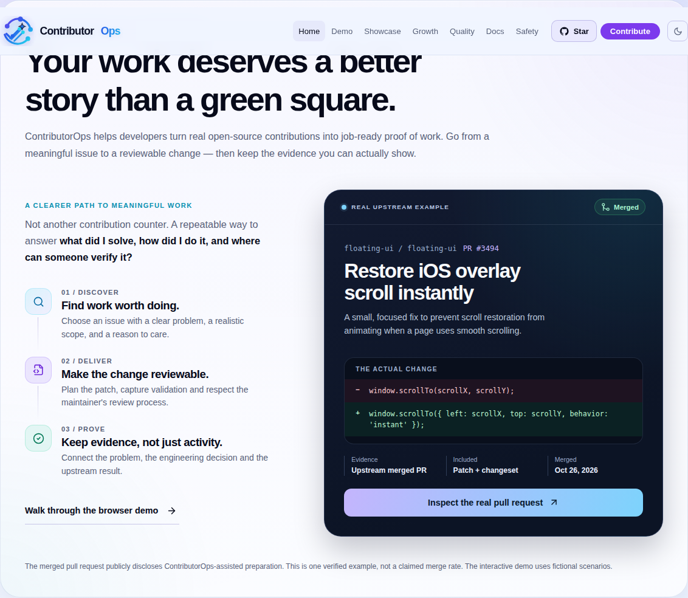
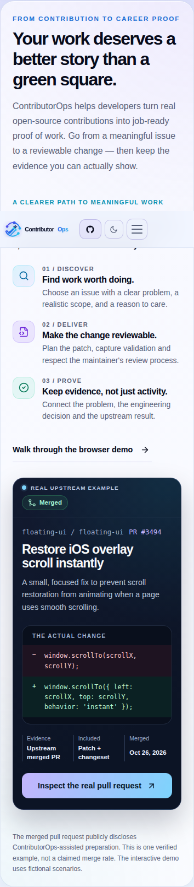

# Contribution → proof: homepage UX acceptance

Redesigned the homepage's `#problem` section, replacing two dense before/after checklists with a focused **Discover → Deliver → Prove** narrative and one independently inspectable engineering artifact.

## What visitors should understand

1. **Value:** select worthwhile OSS problems, deliver reviewable patches, and retain verifiable evidence of engineering judgment
2. **What is real:** [Floating UI PR #3494](https://github.com/floating-ui/floating-ui/pull/3494) was merged upstream October 26, 2026; its PR body discloses ContributorOps-assisted preparation
3. **What is illustrative:** the browser demo uses fictional sample issues, and this one merged PR is not a claim about user success rates or employment outcomes
4. **Next step:** follow the no-login browser walkthrough or inspect the upstream merged PR

## Rendered visual QA

Screenshots were captured from the **built React/Vite site in Chromium** at full desktop and 390px mobile widths. They are not promotional mockups.

| Viewport | Real screenshot |
| --- | --- |
| Desktop, 1440px |  |
| Mobile, 390px |  |

The visual test asserts that the section and real PR link render at both widths, and that no element creates page-wide horizontal overflow. A pre-existing min-content overflow in the mobile hero and footer was also corrected. The exact code change now wraps instead of appearing clipped.

## Acceptance checklist

- [x] Real evidence and fictional demo distinctly labeled
- [x] Product workflow presented as three quickly scannable steps
- [x] Direct links to the interactive demo and independently verifiable upstream PR
- [x] Code and evidence are legible at narrow mobile width
- [x] Keyboard-visible focus styles on both CTAs
- [x] Respect for reduced-motion preference
- [x] Built-site desktop and mobile screenshots with no horizontal overflow
- [ ] Latest PR CI, CodeQL and Lighthouse quality budgets all green before merging
- [ ] Confirm GitHub Pages deploy after merging

## Scope

`apps/site/src/pages/Home.tsx`, `apps/site/src/proof-journey.css`, `apps/site/src/main.tsx`, and the screenshot assets. Does not change sign-in, billing, workflow permissions, analytics, or GitHub writes.
