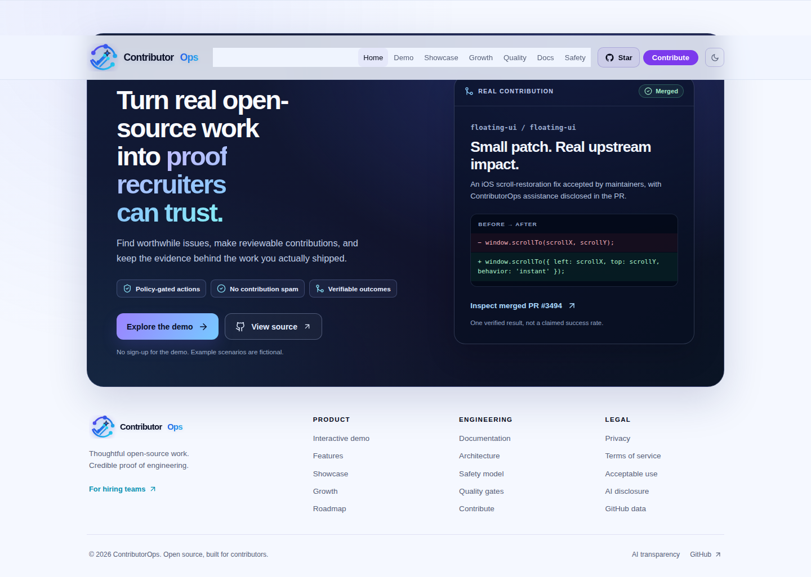
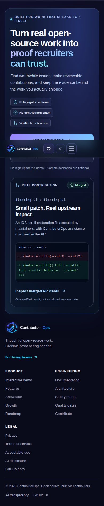

# Footer conversion redesign — visual and usability acceptance

This work **redesigns the global footer** shown in the November 22 screenshot, not the separate homepage contribution-proof section.

## Changes

- Replace the oversized brand card and three circular trust statements with a compact end-of-page conversion panel
- Lead with the value proposition and a clear **Explore the demo** primary action; keep source GitHub access secondary
- Present only a **verified** upstream example — [Floating UI PR #3494](https://github.com/floating-ui/floating-ui/pull/3494) — and explicitly distinguish it from the fictional browser walkthrough
- Replace competing four-card footer navigation with a compact, semantic three-column sitemap and smaller brand row
- Responsive layout; light and dark themes; keyboard-visible focus; reduced-motion-friendly hover transitions; no fabricated metrics or testimonials

## Real Chromium acceptance

[Four-theme/viewport acceptance run](https://github.com/AnkitParekh007/contributorOps/actions/runs/45044383633) completed successfully against an **actual Vite production build**, testing:

- Desktop **1440 × 900** in light and dark modes
- Mobile **390 × 844** in light and dark modes
- Exactly three compact trust indicators and three footer navigation groups
- Demo CTA destination and external merged-PR evidence URL
- Main column stacking below the desktop breakpoint and no page-wide horizontal overflow
- Built site, non-animated screenshot capture, no persistent temporary workflows

Screenshots were re-exported in a [second successful run](https://github.com/AnkitParekh007/contributorOps/actions/runs/45044533798) with the sticky navbar **hidden only during image export** so the browser's sticky header does not obscure part of a tall element screenshot. The actual website keeps sticky navigation.

| Screenshot | Verified output |
| --- | --- |
| Desktop light |  |
| Mobile dark |  |

## Release gate

Require green CI, site-quality/growth checks, Lighthouse budgets, high-severity npm audits, CodeQL and Dependency Review on the final code branch. Merge to `main` only after checks pass and confirm the next GitHub Pages deployment succeeds. This UI change does not modify auth, GitHub write permissions, analytics or deployment credentials.
